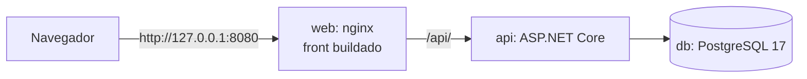

# Finance Dashboard

Dashboard de finanças pessoais em Vue 3 + TypeScript: transações, metas e carteira de criptomoedas com preços em tempo real (CoinGecko). Na primeira visita o app já abre com dados de exemplo, salvos só no navegador; dá para limpar tudo e começar do zero.

> 🔗 **[finance.jteixeira.dev](https://finance.jteixeira.dev)**


## 🚀 Funcionalidades

### Dashboard Principal
- Visualização do saldo total
- Acompanhamento de receitas e despesas mensais
- Gráfico de visão geral mensal
- Gráfico de despesas por categoria
- Lista de transações recentes

### Portfólio de Criptomoedas
- Acompanhamento em tempo real do valor total do portfólio
- Visualização de lucros/perdas
- Gráfico de alocação de ativos
- Histórico de performance do portfólio
- Gerenciamento detalhado de investimentos em criptomoedas
- Rastreamento de preços de múltiplas criptomoedas

## 🛠️ Tecnologias Utilizadas

- **Vue.js 3** - Framework JavaScript progressivo
- **TypeScript** - Superset JavaScript com tipagem estática
- **Tailwind CSS** - Framework CSS utilitário
- **Pinia** - Gerenciamento de estado
- **Vue Router** - Roteamento da aplicação
- **Chart.js** - Biblioteca de gráficos
- **Vite** - Build tool e dev server
- **Vitest** - Testes dos dados de exemplo
- **Axios** - Cliente HTTP

## 📦 Instalação

1. Clone o repositório:
```bash
git clone https://github.com/seu-usuario/finance-dashboard.git
```

2. Instale as dependências:
```bash
cd finance-dashboard
npm install
```

3. Inicie o servidor de desenvolvimento:
```bash
npm run dev
```

## 🔧 Scripts Disponíveis

- `npm run dev` - Inicia o servidor de desenvolvimento
- `npm run build` - Compila o projeto para produção
- `npm run preview` - Visualiza a build de produção localmente

## 📱 Recursos da Interface

- Design responsivo
- Modo escuro/claro
- Gráficos interativos
- Interface intuitiva e moderna
- Componentes reutilizáveis

## 🔒 Ambiente

Para rodar o projeto, você precisará criar um arquivo `.env` na raiz do projeto com as seguintes variáveis:

```env
# Adicione suas variáveis de ambiente aqui
```

## 🧱 v2 · Backend

A v2 adiciona um backend em **.NET 10 + PostgreSQL** (pasta `backend/`) para uso real: login por cookie de sessão, banco de dados e, nas próximas fatias, importação de extratos e patrimônio. O site público na Vercel segue como **demo** (dados de exemplo no navegador, sem login e sem backend); o app real roda localmente pelo Docker Compose, tudo na mesma origem, sem CORS.



Decisões de arquitetura: [ADR 0001 (.NET + Postgres, monólito modular)](docs/adr/0001-dotnet-postgres-monolito-modular.md) e [ADR 0002 (cookie de sessão na mesma origem)](docs/adr/0002-cookie-de-sessao-na-mesma-origem.md).

### Rodando localmente

1. Depois de clonar, ative o hook de pre-commit que roda o gitleaks (hooks não são versionados; sem o gitleaks instalado ele só avisa, não bloqueia):
   ```bash
   git config core.hooksPath .githooks
   ```
2. Crie o `.env` a partir do exemplo e ajuste os valores:
   ```bash
   cp .env.example .env
   ```
   - `POSTGRES_PASSWORD`: apenas letras e números (a senha entra numa connection string).
   - `SEED_USER_EMAIL`: precisa ser um e-mail válido.
   - `SEED_USER_PASSWORD`: no mínimo 12 caracteres e pelo menos um caractere não alfanumérico (política de senha do Identity).
   - Não há cadastro aberto: o usuário inicial é criado a partir de `SEED_USER_EMAIL`/`SEED_USER_PASSWORD`. Se `SEED_*` estiver definido, `Database__MigrateOnStartup` for `false` e não houver schema, a API falha na inicialização (fail-fast). O Compose já define `Database__MigrateOnStartup=true`.
3. Suba a stack:
   ```bash
   docker compose up -d --build
   ```
4. Acesse **http://127.0.0.1:8080** e entre com o usuário do `.env`.
   - Documentação da API (Scalar): http://127.0.0.1:8080/api/docs (especificação em `/api/openapi/v1.json`)
   - Health check: http://127.0.0.1:8080/api/health/ready
   - O Postgres fica publicado só em `127.0.0.1:5432`.

Depois de recriar o container da API (`docker compose up -d --build api`), reinicie também o `web`, porque o nginx resolve o endereço da API uma única vez:

```bash
docker compose restart web
```

### Desenvolvimento

Com o `db` do Compose rodando (`docker compose up -d db`), rode a API localmente (perfil `http`, porta 5288) e o front com Vite; o proxy do Vite encaminha `/api` para a API:

```bash
dotnet run --project backend/src/FinanceDashboard.Api
npm run dev
```

A API local precisa da connection string (`ConnectionStrings__Default`) e, no primeiro uso, de `Database__MigrateOnStartup=true` e das variáveis `SEED_*` no ambiente do processo.

### Testes

```bash
dotnet test backend/FinanceDashboard.sln
```

Os testes de integração usam Postgres real via Testcontainers, então o **Docker precisa estar rodando**. A CI (`.github/workflows/ci.yml`) roda backend, front e gitleaks.

### Backup e restauração

```powershell
powershell -File scripts/backup-db.ps1
powershell -File scripts/restore-db.ps1 -File backups/finance-<data>.sql.gz
```

O backup é gravado em `backups/` (ignorado pelo git). A restauração vai para um banco separado, `finance_restore`, e o script recusa `finance`, `postgres` e `template*`. Resetar o Docker Desktop apaga os volumes: faça backup antes.

### Privacidade

Extratos e faturas reais ficam apenas em `finance-samples/` ou `private/`, ambos ignorados pelo git, assim como `*.ofx`, `*.qfx` e `*.xlsx` (exceto em `backend/tests/fixtures/`). Nunca versione dados reais.

### Roteiro

Próximas fatias: S1 núcleo + Nubank, S2 Itaú, S3 conciliação, S4 investimentos e patrimônio. Detalhes no [design da v2](docs/superpowers/specs/2026-11-02-finance-v2-backend-design.md) e no [plano da fundação (S0)](docs/superpowers/plans/2026-11-02-finance-v2-s0-fundacao.md).

## 🤝 Contribuindo

Contribuições são sempre bem-vindas! Sinta-se à vontade para abrir uma issue ou enviar um pull request.

1. Faça o fork do projeto
2. Crie sua branch de feature (`git checkout -b feature/AmazingFeature`)
3. Commit suas mudanças (`git commit -m 'Add some AmazingFeature'`)
4. Push para a branch (`git push origin feature/AmazingFeature`)
5. Abra um Pull Request

## 📝 Licença

Este projeto está sob a licença ISC.

## 👨‍💻 Autor

JPST - [GitHub](https://github.com/jpst-dev)
