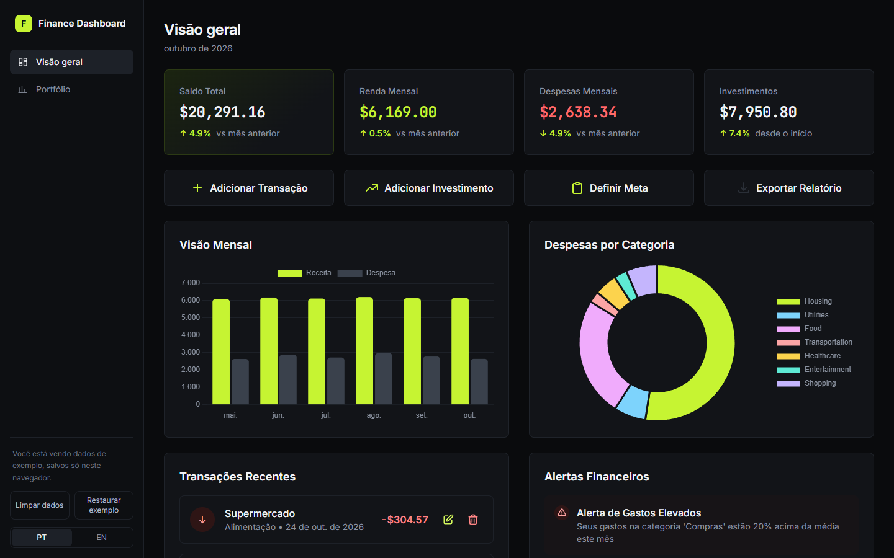
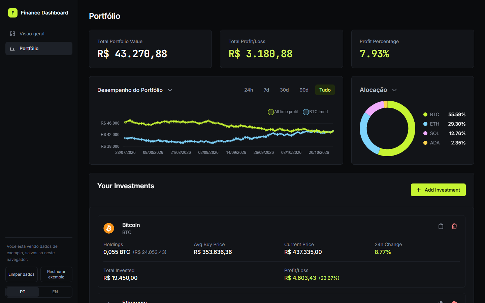
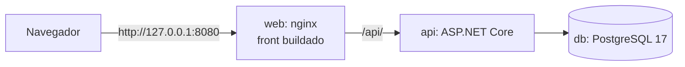

# Finance Dashboard

Dashboard de finanças pessoais em Vue 3 + TypeScript: transações, metas e carteira de criptomoedas com preços em tempo real (CoinGecko). Na primeira visita o app já abre com dados de exemplo, salvos só no navegador; dá para limpar tudo e começar do zero.

> 🔗 **[finance.jteixeira.dev](https://finance.jteixeira.dev)**





## 🚀 Funcionalidades

### Dashboard Principal
- Visualização do saldo total
- Acompanhamento de receitas e despesas mensais
- Gráfico de visão geral mensal
- Gráfico de despesas por categoria
- Lista de transações recentes

### Portfólio de Criptomoedas
- Acompanhamento em tempo real do valor total do portfólio
- Visualização de lucros/perdas
- Gráfico de alocação de ativos
- Histórico de performance do portfólio
- Gerenciamento detalhado de investimentos em criptomoedas
- Rastreamento de preços de múltiplas criptomoedas

## 🛠️ Tecnologias Utilizadas

- **Vue.js 3** - Framework JavaScript progressivo
- **TypeScript** - Superset JavaScript com tipagem estática
- **Tailwind CSS** - Framework CSS utilitário
- **Pinia** - Gerenciamento de estado
- **Vue Router** - Roteamento da aplicação
- **Chart.js** - Biblioteca de gráficos
- **Vite** - Build tool e dev server
- **Vitest** - Testes dos dados de exemplo
- **Axios** - Cliente HTTP

## 📦 Instalação

1. Clone o repositório:
```bash
git clone https://github.com/seu-usuario/finance-dashboard.git
```

2. Instale as dependências:
```bash
cd finance-dashboard
npm install
```

3. Inicie o servidor de desenvolvimento:
```bash
npm run dev
```

## 🔧 Scripts Disponíveis

- `npm run dev` - Inicia o servidor de desenvolvimento
- `npm run build` - Compila o projeto para produção
- `npm run preview` - Visualiza a build de produção localmente

## 📱 Recursos da Interface

- Design responsivo
- Modo escuro/claro
- Gráficos interativos
- Interface intuitiva e moderna
- Componentes reutilizáveis

## 🔒 Ambiente

Para rodar o projeto, você precisará criar um arquivo `.env` na raiz do projeto com as seguintes variáveis:

```env
# Adicione suas variáveis de ambiente aqui
```

## 🧱 v2 · Backend

A v2 adiciona um backend em **.NET 10 + PostgreSQL** (pasta `backend/`) para uso real: login por cookie de sessão, banco de dados e, nas próximas fatias, importação de extratos e patrimônio. O site público na Vercel segue como **demo** (dados de exemplo no navegador, sem login e sem backend); o app real roda localmente pelo Docker Compose, tudo na mesma origem, sem CORS.



Decisões de arquitetura: [ADR 0001 (.NET + Postgres, monólito modular)](docs/adr/0001-dotnet-postgres-monolito-modular.md), [ADR 0002 (cookie de sessão na mesma origem)](docs/adr/0002-cookie-de-sessao-na-mesma-origem.md), [ADR 0003 (importação idempotente e desfazer)](docs/adr/0003-importacao-idempotente-e-desfazer.md) e [ADR 0004 (modo de build e camada de API do front)](docs/adr/0004-modo-de-build-e-camada-de-api-do-front.md).

### Rodando localmente

1. Depois de clonar, ative o hook de pre-commit que roda o gitleaks (a pasta `.githooks/` é versionada, mas a configuração `core.hooksPath` não, então cada clone precisa ativá-la; sem o gitleaks instalado ele só avisa, não bloqueia):
   ```bash
   git config core.hooksPath .githooks
   ```
2. Crie o `.env` a partir do exemplo e ajuste os valores:
   ```bash
   cp .env.example .env
   ```
   - `POSTGRES_PASSWORD`: apenas letras e números (a senha entra numa connection string).
   - `SEED_USER_EMAIL`: precisa ser um e-mail válido.
   - `SEED_USER_PASSWORD`: no mínimo 12 caracteres, com letra maiúscula, letra minúscula, dígito e pelo menos um caractere não alfanumérico (política de senha do Identity). Se a senha não cumprir a regra, a API não sobe; se ela ficar reiniciando, rode `docker compose logs api`.
   - Não há cadastro aberto: o usuário inicial é criado a partir de `SEED_USER_EMAIL`/`SEED_USER_PASSWORD`. Se `SEED_*` estiver definido, `Database__MigrateOnStartup` for `false` e não houver schema, a API falha na inicialização (fail-fast). O Compose já define `Database__MigrateOnStartup=true`.
3. Suba a stack:
   ```bash
   docker compose up -d --build
   ```
4. Acesse **http://127.0.0.1:8080**. O front servido pelo Compose é o **modo real** (veja [Modo real (interface)](#modo-real-interface)): entre com o usuário criado a partir de `SEED_USER_EMAIL`/`SEED_USER_PASSWORD`. A API também pode ser exercitada em `/api/docs` ou com `curl` (cookie jar + token antiforgery):
   ```bash
   curl -s -c jar.txt -b jar.txt http://127.0.0.1:8080/api/auth/csrf
   # copie o valor de "token" da resposta e use em X-XSRF-TOKEN:
   curl -s -c jar.txt -b jar.txt -X POST http://127.0.0.1:8080/api/auth/login      -H "Content-Type: application/json" -H "X-XSRF-TOKEN: <token>"      -d '{"email":"<SEED_USER_EMAIL>","password":"<SEED_USER_PASSWORD>"}'
   curl -s -b jar.txt http://127.0.0.1:8080/api/auth/me
   ```
   - Documentação da API (Scalar): http://127.0.0.1:8080/api/docs (especificação em `/api/openapi/v1.json`)
   - Health check: http://127.0.0.1:8080/api/health/ready
   - O Postgres fica publicado só em `127.0.0.1:5432`.

Depois de recriar o container da API (`docker compose up -d --build api`), reinicie também o `web`, porque o nginx resolve o endereço da API uma única vez:

```bash
docker compose restart web
```

### Modo real (interface)

O mesmo código-fonte gera **dois builds**, escolhidos em tempo de build pela variável `VITE_APP_MODE`:

| Build | Comando | Saída | Uso |
| --- | --- | --- | --- |
| `demo` (padrão) | `npm run build` | `dist/` | Vercel: dados de exemplo no navegador, sem login e sem backend |
| `real` | `npm run build:real` (usa `.env.real`, `VITE_APP_MODE=real`) | `dist-real/` | Imagem Docker do `web` (nginx), falando com a API na mesma origem |

Só o valor exato `real` ativa o modo real; qualquer outro (ou ausente) cai no `demo`, então a Vercel continua intacta. Cada bundle não contém código do outro modo (ver [ADR 0004](docs/adr/0004-modo-de-build-e-camada-de-api-do-front.md)). O modo real tem login, Visão geral (resumo calculado no servidor), Lançamentos, Pendentes de classificação, Contas e Importar (OFX Nubank com prévia, classificação das pendentes, confirmação e desfazer pelo histórico).

**Como rodar (Compose):**

```bash
docker compose up -d --build
```

Abra **http://127.0.0.1:8080** e entre com o usuário inicial definido no `.env` (`SEED_USER_EMAIL` / `SEED_USER_PASSWORD`). Depois de mudar o front, basta `docker compose up -d --build web`.

**Desenvolvimento:** com a API local na porta 5288 (veja [Desenvolvimento](#desenvolvimento)), rode na raiz:

```bash
npm run dev:real
```

O Vite encaminha `/api` para `http://localhost:5288`, mantendo a mesma origem.

**Esconder valores:** o botão "Esconder valores" na barra lateral troca todo dinheiro por `••••` (texto, atributos acessíveis e título da página), sem nova chamada à API. A preferência fica no navegador (`localStorage`, chave `fd.hideValues`); o idioma (pt-BR/en-US) fica em `fd.locale`. Nada disso vai ao servidor.

**Tipos da API e contrato:** os tipos do front são gerados a partir do OpenAPI versionado em `backend/openapi/v1.json`:

```bash
npm run api:types
```

Depois de mudar endpoints ou DTOs, regenere antes o snapshot do OpenAPI e, em seguida, os tipos:

```bash
UPDATE_OPENAPI_SNAPSHOT=1 dotnet test backend/FinanceDashboard.sln --filter "FullyQualifiedName~OpenApiSnapshot"
npm run api:types
```

**Checagens na CI:** além dos testes, a CI regenera os tipos e falha se `src/real/api/schema.d.ts` divergir do commit (`git diff --exit-code`), e roda `node scripts/check-bundles.mjs`, que falha se o bundle `dist/` contiver o marcador do modo real ou se `dist-real/` contiver código do modo demo (ou faltar o marcador). O teste `src/real/e2e-smoke.test.ts` percorre o fluxo completo (login, conta, importação com classificação, resumo, esconder valores, desfazer) com uma API simulada.

**Fora desta fatia:** o demo estático com a mesma interface (S1c), o importador do Itaú (S2) e conciliação, investimentos e patrimônio (S3/S4). Metas, criptomoedas e investimentos ficam escondidos no modo real (continuam só no demo).

### Importando um extrato Nubank (S1a)

A API aceita o OFX do Nubank (conta corrente e cartão), mostra uma **prévia** e só grava depois da confirmação. Tudo pode ser exercitado pelo `curl` (ou pelo Scalar). O token antiforgery está **atrelado à identidade**: depois do login é preciso pedir um **novo** token em `/api/auth/csrf`.

```bash
B=http://127.0.0.1:8080
J=jar.txt

# 1) token antes do login e login
T=$(curl -s -c $J -b $J $B/api/auth/csrf | sed -E 's/.*"token":"([^"]+)".*/\1/')
curl -s -c $J -b $J -X POST $B/api/auth/login -H "Content-Type: application/json" -H "X-XSRF-TOKEN: $T" \
  -d '{"email":"<SEED_USER_EMAIL>","password":"<SEED_USER_PASSWORD>"}'

# 2) novo token (agora ligado ao usuário logado)
T=$(curl -s -c $J -b $J $B/api/auth/csrf | sed -E 's/.*"token":"([^"]+)".*/\1/')

# 3) criar a conta (Checking para conta corrente, CreditCard para cartão)
ACC=$(curl -s -c $J -b $J -X POST $B/api/accounts -H "Content-Type: application/json" -H "X-XSRF-TOKEN: $T" \
  -d '{"name":"Nubank conta","type":"Checking","institution":"Nubank"}' | sed -E 's/.*"id":"([^"]+)".*/\1/')

# 4) enviar o OFX (multipart: file + accountId) -> prévia (200); nada foi gravado ainda
BATCH=$(curl -s -c $J -b $J -X POST $B/api/imports -H "X-XSRF-TOKEN: $T" \
  -F "accountId=$ACC" -F "file=@extrato.ofx" | sed -E 's/.*"batchId":"([^"]+)".*/\1/')
curl -s -b $J $B/api/imports/$BATCH          # reler a prévia (novas, existentes, avisos)

# 5) confirmar (200); avisos bloqueantes exigem {"acknowledgeBlockingWarnings":true}
curl -s -c $J -b $J -X POST $B/api/imports/$BATCH/confirm -H "Content-Type: application/json" \
  -H "X-XSRF-TOKEN: $T" -d '{"acknowledgeBlockingWarnings":false}'

# 6) resumo do mês, calculado no servidor
curl -s -b $J "$B/api/summary?month=2026-10"

# 7) desfazer o lote (204)
curl -s -o /dev/null -w "%{http_code}\n" -c $J -b $J -X POST $B/api/imports/$BATCH/undo -H "X-XSRF-TOKEN: $T"
```

Regras e limites:

- **Limites do upload**: 1 arquivo `.ofx` de até **5 MB** (o nginx aceita até 6 MB de corpo; acima disso `413`). O formato é validado pelo conteúdo: arquivo vazio, não-OFX ou com `<!DOCTYPE`/entidades responde `422` com um código de erro, sem repetir o conteúdo. O arquivo **não é guardado**; só a prévia fica no servidor, por **24 h**. Depois disso a confirmação é recusada e é preciso enviar de novo.
- **Idempotência**: reenviar o mesmo arquivo, ou outro com períodos sobrepostos, não duplica lançamentos (identidade = conta + FITID + ordinal). Veja o [ADR 0003](docs/adr/0003-importacao-idempotente-e-desfazer.md).
- **Pendentes de classificação**: pagamento de fatura, pagamento recebido, transferências (enviada/recebida) e Pix no Crédito entram com `state = PendingClassification`; as compras comuns entram como `Normal`, sem categoria. Elas **ficam fora do resumo** (receitas, despesas e categorias) e são só contadas em `pending: { count, total }` até serem reclassificadas. Para reclassificar, use `PUT /api/transactions/{id}` com `state` (`Normal`) e/ou `categoryId`; a linha passa a contar no resumo.
- **Exclusão lógica**: `DELETE /api/transactions/{id}` de uma linha importada a marca como excluída (marcador); ela some das listagens e do resumo e **não volta** se o mesmo arquivo for importado de novo.
- **Desfazer**: `POST /api/imports/{id}/undo` apaga as linhas criadas pelo lote (inclusive as excluídas logicamente) e o checkpoint de saldo que ele gerou, e libera o arquivo para reimportar. Atenção: se outro lote sobreposto "pulou" linhas que o primeiro criou, desfazer o primeiro **remove essas linhas também**; reimporte o arquivo para recuperá-las. Desfazer uma prévia apenas a descarta.
- **Documentação interativa**: abra **http://127.0.0.1:8080/api/docs** (Scalar). Faça login pelas rotas `/api/auth/*` e use o campo de cabeçalho `X-XSRF-TOKEN` nas chamadas que alteram dados; a especificação OpenAPI fica em `/api/openapi/v1.json`.

### Importando Itaú (S2)

O mesmo `POST /api/imports` aceita os arquivos do Itaú. O leitor é escolhido pelo **conteúdo** (nunca pela extensão):

| Arquivo | Conta | Como é lido |
|---|---|---|
| Extrato da conta, `.ofx` (`BANKID` 0341) | `Checking` | OFX tolerante (SGML, CP1252); `LEDGERBAL` vira checkpoint só se nenhuma linha for posterior ao `DTASOF` |
| Fatura do cartão, `.xlsx` | `CreditCard` | Primeira planilha visível; colunas pelo rótulo do cabeçalho (`Data`, `Lançamento`, `Parcelamento`, `Valor`, `Tipo do cartão`, `Número do cartão`); resumo com `Cartão`/`Valor`/`Vencimento` |

Fonte e tipo de conta precisam combinar (`422 account_type_mismatch`). Os passos 1–3 e 5–7 são os do Nubank acima; só muda a conta e o arquivo:

```bash
# conta do cartão
CARD=$(curl -s -c $J -b $J -X POST $B/api/accounts -H "Content-Type: application/json" -H "X-XSRF-TOKEN: $T" \
  -d '{"name":"Itaú cartão","type":"CreditCard","institution":"Itaú"}' | sed -E 's/.*"id":"([^"]+)".*/\1/')

# prévia da fatura (o arquivo não é guardado)
BATCH=$(curl -s -c $J -b $J -X POST $B/api/imports -H "X-XSRF-TOKEN: $T" \
  -F "accountId=$CARD" -F "file=@fatura.xlsx" | sed -E 's/.*"batchId":"([^"]+)".*/\1/')
curl -s -b $J $B/api/imports/$BATCH   # vencimento, total declarado, linhas com parcela/cartão e avisos
```

Regras:

- **Identidade por conteúdo**: o Itaú não tem ID confiável por linha, então cada lançamento é identificado por um hash do conteúdo normalizado + a ordem da repetição no arquivo (dois Pix idênticos no mesmo dia são duas linhas). Reimportar o mesmo arquivo, outra exportação do mesmo período ou uma fatura aberta que cresceu insere só o que falta. Os mesmos bytes já confirmados respondem `409 already_imported`. Detalhes no [ADR 0005](docs/adr/0005-identidade-por-conteudo-e-leitores-itau.md).
- **Sinais**: a fatura do Itaú vem com cobrança positiva; o leitor inverte (cobrança negativa, pagamento/estorno positivo).
- **Pendentes de classificação**: na conta, `FATURA PAGA`, `PIX TRANSF`, `PIX CARTAO`, `PAG BOLETO`, `CREDITO LIBERAD`, `EST CRED`, `CREDITO CONSIGNADO`, `APLICACAO` e `RESGATE`; na fatura, o pagamento da fatura anterior e `SALDO ANTERIOR`/rotativo. O resto entra como `Normal`.
- **Parcelas**: guardam número/total, data da compra e vencimento; a parcela 2 em diante conta no resumo em "vencimento − 1 mês".
- **Avisos**: `InvoiceTotalMismatch` (total declarado ≠ soma das linhas que não são pagamento; bloqueia, aceita `acknowledgeBlockingWarnings`), `LedgerBalanceBeforeLastLine`, `PossibleDuplicate`, `UnknownLineKinds` e `UnknownCardSuffix` (só avisam), além dos do Nubank.
- **Fatura com linhas faltando**: se a fatura (mesma conta e vencimento) já tem linhas confirmadas que não aparecem no arquivo novo, a prévia mostra `InvoiceHasMissingLines`, que **bloqueia sem override** (o confirm dá `409 blocking_warnings` mesmo com `acknowledgeBlockingWarnings`). Desfaça o lote anterior dessa fatura e importe de novo. Nada é apagado ou substituído sozinho. Use uma conta `CreditCard` por cartão: dois cartões com o mesmo vencimento na mesma conta se bloqueiam.
- **Desfazer**: igual ao Nubank. Linhas que você **excluiu** continuam ocupando a chave e não voltam ao reimportar.
- **Erros de arquivo** (`422`, só com o código): `unsupported_bank`, `not_xlsx`, `encrypted_xlsx`, `xlsx_limits_exceeded`, `xlsx_unsafe_content` (macro, link externo, conteúdo embutido), `unsupported_layout` (layout desconhecido) e `invalid_cell` (a resposta traz só o código; a linha da planilha fica apenas no diagnóstico interno e nos testes, nunca na resposta nem nos logs). Fórmulas nunca são avaliadas.

### Desenvolvimento

O `db` do Compose precisa estar rodando (`docker compose up -d db`; fica em `127.0.0.1:5432`). A API local usa a porta 5288 (perfil `http`) e o serviço `api` do Compose não publica porta no host, então não há conflito e não é preciso parar a stack. O Vite encaminha `/api` para `http://localhost:5288`.

Defina as variáveis no terminal onde vai rodar a API (substitua os placeholders pelos valores do seu `.env`):

PowerShell:

```powershell
$env:ConnectionStrings__Default = "Host=localhost;Port=5432;Database=finance;Username=postgres;Password=<POSTGRES_PASSWORD do .env>"
$env:Database__MigrateOnStartup = "true"
$env:SEED_USER_EMAIL = "<SEED_USER_EMAIL do .env>"
$env:SEED_USER_PASSWORD = "<SEED_USER_PASSWORD do .env>"
dotnet run --project backend/src/FinanceDashboard.Api --launch-profile http
```

bash:

```bash
export ConnectionStrings__Default="Host=localhost;Port=5432;Database=finance;Username=postgres;Password=<POSTGRES_PASSWORD do .env>"
export Database__MigrateOnStartup=true
export SEED_USER_EMAIL="<SEED_USER_EMAIL do .env>"
export SEED_USER_PASSWORD="<SEED_USER_PASSWORD do .env>"
dotnet run --project backend/src/FinanceDashboard.Api --launch-profile http
```

Em outro terminal, na raiz do repositório:

```bash
npm run dev
```

### Testes

```bash
dotnet test backend/FinanceDashboard.sln
```

Os testes de integração usam Postgres real via Testcontainers, então o **Docker precisa estar rodando**. A CI (`.github/workflows/ci.yml`) roda backend, front e gitleaks.

Na máquina que tem `finance-samples/` (ignorada pelo git), a suíte `LocalSamples` lê os extratos e faturas reais, confere chaves, ordinais, sinais, total da fatura e datas de parcela, e reimporta cada arquivo numa base do Testcontainers; sem a pasta (e sempre na CI) ela é pulada. As mensagens de falha são fixas e nunca mostram conteúdo dos arquivos:

```bash
dotnet test backend/FinanceDashboard.sln --filter "FullyQualifiedName~LocalSamples"
```

O contrato OpenAPI fica versionado em `backend/openapi/v1.json` e um teste falha se ele divergir da API. Depois de mudar endpoints ou DTOs, regenere o arquivo (o front gera os tipos a partir dele):

```bash
UPDATE_OPENAPI_SNAPSHOT=1 dotnet test backend/FinanceDashboard.sln --filter "FullyQualifiedName~OpenApiSnapshot"
```

### Backup e restauração

```powershell
powershell -File scripts/backup-db.ps1
powershell -File scripts/restore-db.ps1 -File backups/finance-<data>.sql.gz
```

O backup é gravado em `backups/` (ignorado pelo git). A restauração vai para um banco separado, `finance_restore`, e o script recusa `finance`, `postgres` e `template*`. Resetar o Docker Desktop apaga os volumes: faça backup antes.

### Privacidade

Extratos e faturas reais ficam apenas em `finance-samples/` ou `private/`, ambos ignorados pelo git, assim como `*.ofx`, `*.qfx` e `*.xlsx` (exceto em `backend/tests/fixtures/`). Nunca versione dados reais.

### Roteiro

Entregue: S0 fundação, S1a API de núcleo + importação Nubank, S1b interface do modo real e S2 importadores do Itaú (conta OFX e fatura xlsx). Próximas fatias: S1c demo estático com a nova interface, S3 conciliação, S4 investimentos e patrimônio. Detalhes no [design da v2](docs/superpowers/specs/2026-11-02-finance-v2-backend-design.md) e no [plano da fundação (S0)](docs/superpowers/plans/2026-11-02-finance-v2-s0-fundacao.md).

## 🤝 Contribuindo

Contribuições são sempre bem-vindas! Sinta-se à vontade para abrir uma issue ou enviar um pull request.

1. Faça o fork do projeto
2. Crie sua branch de feature (`git checkout -b feature/AmazingFeature`)
3. Commit suas mudanças (`git commit -m 'Add some AmazingFeature'`)
4. Push para a branch (`git push origin feature/AmazingFeature`)
5. Abra um Pull Request

## 📝 Licença

Este projeto está sob a licença ISC.

## 👨‍💻 Autor

JPST - [GitHub](https://github.com/jpst-dev)
