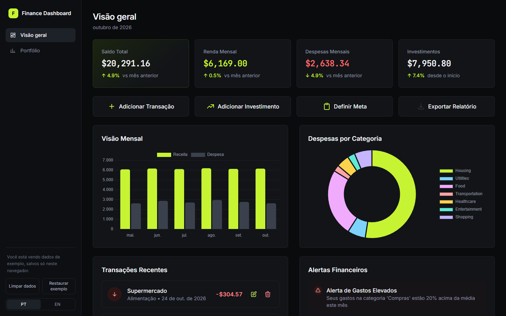
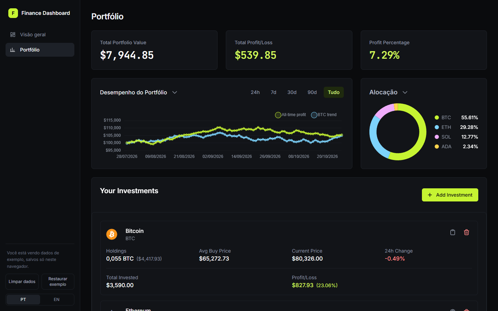

# Finance Dashboard

Dashboard de finanças pessoais em Vue 3 + TypeScript: transações, metas e carteira de criptomoedas com preços em tempo real (CoinGecko). Na primeira visita o app já abre com dados de exemplo, salvos só no navegador; dá para limpar tudo e começar do zero.

> 🔗 **[finance.jteixeira.dev](https://finance.jteixeira.dev)**





## 🚀 Funcionalidades

### Dashboard Principal
- Visualização do saldo total
- Acompanhamento de receitas e despesas mensais
- Gráfico de visão geral mensal
- Gráfico de despesas por categoria
- Lista de transações recentes

### Portfólio de Criptomoedas
- Acompanhamento em tempo real do valor total do portfólio
- Visualização de lucros/perdas
- Gráfico de alocação de ativos
- Histórico de performance do portfólio
- Gerenciamento detalhado de investimentos em criptomoedas
- Rastreamento de preços de múltiplas criptomoedas

## 🛠️ Tecnologias Utilizadas

- **Vue.js 3** - Framework JavaScript progressivo
- **TypeScript** - Superset JavaScript com tipagem estática
- **Tailwind CSS** - Framework CSS utilitário
- **Pinia** - Gerenciamento de estado
- **Vue Router** - Roteamento da aplicação
- **Chart.js** - Biblioteca de gráficos
- **Vite** - Build tool e dev server
- **Vitest** - Testes dos dados de exemplo
- **Axios** - Cliente HTTP

## 📦 Instalação

1. Clone o repositório:
```bash
git clone https://github.com/seu-usuario/finance-dashboard.git
```

2. Instale as dependências:
```bash
cd finance-dashboard
npm install
```

3. Inicie o servidor de desenvolvimento:
```bash
npm run dev
```

## 🔧 Scripts Disponíveis

- `npm run dev` - Inicia o servidor de desenvolvimento
- `npm run build` - Compila o projeto para produção
- `npm run preview` - Visualiza a build de produção localmente

## 📱 Recursos da Interface

- Design responsivo
- Modo escuro/claro
- Gráficos interativos
- Interface intuitiva e moderna
- Componentes reutilizáveis

## 🔒 Ambiente

Para rodar o projeto, você precisará criar um arquivo `.env` na raiz do projeto com as seguintes variáveis:

```env
# Adicione suas variáveis de ambiente aqui
```

## 🤝 Contribuindo

Contribuições são sempre bem-vindas! Sinta-se à vontade para abrir uma issue ou enviar um pull request.

1. Faça o fork do projeto
2. Crie sua branch de feature (`git checkout -b feature/AmazingFeature`)
3. Commit suas mudanças (`git commit -m 'Add some AmazingFeature'`)
4. Push para a branch (`git push origin feature/AmazingFeature`)
5. Abra um Pull Request

## 📝 Licença

Este projeto está sob a licença ISC.

## 👨‍💻 Autor

JPST - [GitHub](https://github.com/jpst-dev)
